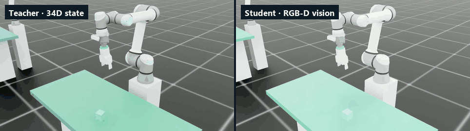

# UR5e Sim2Real Bin Picking

**UR5e · OnRobot 2FG7 · Intel RealSense D435i** — NVIDIA Isaac Lab에서 학습한 비전 기반 pick-and-place 정책을, 같은 관측·행동·안전 계약을 유지한 채 실제 로봇으로 옮기는 Sim2Real 프로젝트입니다.

[](https://github.com/ChangeDayAndNight/UR5e_SIM2REAL-public/actions/workflows/ci.yml)
[](LICENSE)

**[프로젝트 개요 페이지](https://changedayandnight.github.io/UR5e_SIM2REAL-public/)** · [실기 배포 가이드](DEPLOY_GUIDE.md) · [프로젝트 원장 — 설계 계약과 실패 기록 F01–F99](PROJECT_LOG.md)

<p align="center">
  
  <br><sub>채택된 Teacher(왼쪽, 34D 상태 관측)와 Vision Student(오른쪽, RGB-D 영상 관측)의 Isaac Sim 롤아웃</sub>
</p>

## 개요

정적 작업면 위의 5 cm 큐브를 집어, 에피소드마다 바뀌는 목표 위치에 놓는 과제입니다.

1. **Teacher (PPO)** — 실기에서도 만들 수 있는 34D 상태만 관측합니다. 큐브 위치는 참값이 아니라, 실기 depth 인식 모듈과 같은 규칙(결측·편향·노이즈)으로 만든 추정치입니다. critic만 sim 참값을 보는 비대칭 actor-critic 구조입니다.
2. **Vision Student (증류)** — 채택된 Teacher의 행동을 정답으로 삼아, 손목 카메라 RGB-D 영상(관측 50,206D)만 보는 정책으로 증류합니다.
3. **배포** — sim과 실기가 관측 전처리·행동 매핑·안전 제한 코드를 공유하고, 캘리브레이션이나 안전 증거가 없으면 실행을 거부(fail-closed)합니다.

## 결과 — sim 봉인 평가

| 정책 | 관측 | 성공률 (placed) | Wilson 95% 하한 | 배포 번들 |
|---|---|---|---|---|
| Teacher | 34D 상태 + depth 인식 추정치 | **100.00%** (2,048 / 2,048) | 99.81% | [`exported_experimental/teacher_177c7eefed0f`](exported_experimental/teacher_177c7eefed0f/DEPLOY_README.md) |
| Vision Student | RGB-D 영상 50,206D | **94.53%** (1,936 / 2,048) | 93.46% | [`exported_experimental/student_8b415b9b0831`](exported_experimental/student_8b415b9b0831/DEPLOY_README.md) |

평가 조건은 seed 42–45 × 512 에피소드, 보조 동작 없음, 인식 오차 domain randomization과 실기 속도 상한을 적용한 상태입니다. **실기 성공률은 아직 측정하지 않았고**, 두 번들은 사람이 e-stop 앞에서 운용하는 랩 실험 레인(`adopted: false`)입니다.

## 핵심 설계

- **배포 가능한 관측만 학습** — 실기에서 만들 수 없는 신호(손가락 위치·물체 속도·접촉력)를 관측에서 뺐습니다. 인식 오차·결측과 실행 속도 상한을 학습 분포에 넣었습니다.
- **sim·실기 단일 소스** — 관측 전처리(`common/obs_preprocess.py`)와 행동 매핑을 sim과 실기가 같은 코드로 씁니다. `obs_spec.json`이 관측 순서·크기·설정 해시를 봉인합니다.
- **봉인된 평가와 채택** — 후보는 학습 중 성공률의 trailing median으로 고르고, 4 seed × 512 에피소드 평가와 Wilson 하한 게이트를 통과해야 다음 단계로 넘어갑니다. 권한은 `adoption.json`과 체크포인트 SHA-256에만 있습니다.
- **fail-closed 배포** — 해시·설정·캘리브레이션·증거가 어긋나면 기동하지 않습니다. 모션은 명시적 인가 플래그로만 허용합니다.
- **실패 원장** — F01–F99의 실패·결정 기록(문제 → 기전 → 조치 → 교훈)을 [PROJECT_LOG.md](PROJECT_LOG.md)에 남겼습니다. 예: 한쪽 손가락으로 집어도 sim 성공률 99.6%가 나온 그리퍼 변환 결함(F91), DLSS 경로에서 RGB 렌더만 죽은 결함(F94).

## 요구 사항

| 하고 싶은 일 | 필요한 것 |
|---|---|
| 코드 읽기 · 테스트 | Python 3.11 (Isaac Sim·GPU·하드웨어 불필요, OS 무관) |
| 시뮬레이션 체험 · 학습 | Windows 11, NVIDIA GPU(VRAM 8 GB 이상, 기준 RTX 3060 Ti) + 최신 드라이버, Git, Miniconda, PowerShell 5.1+, Isaac Sim·Isaac Lab 설치 공간 |
| 실기 배포 | Windows 11 PC(Isaac 불필요), Miniconda, UR5e(RTDE), OnRobot 2FG7(DO 배선), RealSense D435i(손목 장착) |

학습·배포는 Windows 11 native만 지원합니다(WSL 미지원). 모든 경로는 저장소 루트 기준 상대 경로라, 어느 폴더에 clone해도 그대로 동작합니다.

## 빠른 시작

모든 명령은 저장소 루트에서 PowerShell로 실행합니다.

```powershell
git clone https://github.com/ChangeDayAndNight/UR5e_SIM2REAL-public.git
cd UR5e_SIM2REAL-public
```

### 1. 시뮬레이션에서 학습된 정책 보기 (Isaac Sim 필요)

```powershell
# 처음 한 번: conda 환경 isaac51에 Isaac Sim 5.1 · Isaac Lab v2.3.2(고정 커밋) · PyTorch · 프로젝트 확장 설치
powershell -ExecutionPolicy Bypass -File scripts/bootstrap_training.ps1

conda activate isaac51
$env:PYTHONIOENCODING="utf-8"

# 채택된 Teacher 번들을, 실기와 같은 인식 경로(depth 추정치 관측)로 GUI에서 5 에피소드 실행
python Phase3/SimDeploy_Rehearsal_Teacher.py --policy-dir exported_experimental/teacher_177c7eefed0f --gui --episodes 5
```

### 2. 처음부터 학습

```powershell
# 파이프라인 smoke: 16 env · 1 iteration (환경·자산·계약 preflight 포함)
powershell -ExecutionPolicy Bypass -File scripts/train.ps1 -Preset Teacher -Smoke

# Teacher 본 학습 — 채택 run 설정(16 GB GPU, 16,384 env). 8 GB GPU는 -NumEnvs 4096부터, OOM이면 절반씩 줄인다
powershell -ExecutionPolicy Bypass -File scripts/train.ps1 -Preset Teacher -NumEnvs 16384 -MaxIterations 25000 -Seed 42 -Headless

# 채택된 Teacher 체크포인트에서 RGB-D Student 증류 — 채택 run 설정(512 env)
powershell -ExecutionPolicy Bypass -File scripts/train.ps1 -Preset Distill -DistillFrom <TEACHER_MODEL_PT> -NumEnvs 512 -MaxIterations 25000 -Seed 42 -Headless
```

학습 산출물은 `logs/`에 쌓이며 Git 대상이 아닙니다. 채택 평가, 정책 export, 리허설 절차는 [PROJECT_LOG.md](PROJECT_LOG.md) §2–§4에 있습니다.

### 3. 실기 배포 (Isaac Sim 불필요)

```powershell
# conda 환경 env_ur_real · 의존성 · configs\real.local.yaml 템플릿 생성 · 배포 점검 런북 (로봇 없이도 여기까지 동작)
powershell -ExecutionPolicy Bypass -File setup.ps1

conda activate env_ur_real
$env:PYTHONIOENCODING="utf-8"

# 1) configs\real.local.yaml 에 로봇 IP와 카메라 시리얼 입력, TCP offset · hand-eye 캘리브레이션
# 2) 추론만(모션 없음) — 인식 검출률이 30% 미만이면 3)으로 가지 않는다
python Phase4\Run_Task_Teacher.py --policy-dir exported_experimental\teacher_177c7eefed0f `
    --dry-run --verbose-perception --target-pos="-0.50,0.15,-0.0125"

# 3) 실제 모션 — 사람이 e-stop 앞에서
python Phase4\Run_Task_Teacher.py --policy-dir exported_experimental\teacher_177c7eefed0f `
    --yes-i-am-at-the-estop --home-first --target-pos="-0.50,0.15,-0.0125"
```

Vision Student는 `Phase4\Run_Task.py --policy-dir exported_experimental\student_8b415b9b0831`로 같은 순서를 밟습니다. 캘리브레이션, 그리퍼 펄스 실측, 안전 수칙은 [DEPLOY_GUIDE.md](DEPLOY_GUIDE.md)를 따릅니다.

### 4. 테스트 (Isaac Sim·하드웨어 불필요)

CI와 같은 구성입니다. Python 3.11 가상환경에서 실행합니다.

```bash
python -m pip install torch==2.7.0 --index-url https://download.pytorch.org/whl/cpu
python -m pip install numpy==1.26.0 pyyaml==6.0.3 pytest==9.1.1 gymnasium==1.2.1 toml==0.10.2 pandas==3.0.3 matplotlib==3.10.3 psutil==5.9.8 openpyxl==3.1.5 tensorboard==2.21.0 opencv-python-headless==4.11.0.86
python -m pip install --no-deps ./source/ur5e_binpick
python scripts/validate_repository.py
python -m pytest tests/
```

## 저장소 구조

```text
Phase0/ … Phase4/        단계별 실행 스크립트: scene smoke → Teacher → Student → 리허설 → 실기
source/ur5e_binpick/     Isaac Lab 확장 패키지 (태스크 · MDP · 에이전트 설정)
common/                  sim·실기 공유 순수 로직 (관측 전처리 · 행동 매핑 · 그리퍼 상태 · 큐브 인식)
sim/  real/              같은 인터페이스의 sim / 실기 로봇·카메라 어댑터
deployment/              캘리브레이션 · 패리티 검증 · 배포 번들 · 배포 PC 런북
configs/                 계약을 소유하는 설정 (common · sim · dr · safety · calib)
exported_experimental/   sim 채택 정책 번들 2종 (TorchScript + 관측 명세 + 설정 사본)
scripts/                 학습 런처(train.ps1) · 환경 설치 · 채택 파이프라인 · 저장소 검증
analysis/  diagnostics/  평가 통계 · 논문 표 / 물리 · 렌더 · 가시성 프로브
tests/                   Isaac·하드웨어 없이 도는 순수 pytest
docs/                    프로젝트 개요 페이지 (GitHub Pages)
```

## 한계

- 실기 성공률은 아직 측정하지 않았습니다. sim 수치는 실기 인식 오차가 학습 범위(편향 1 cm 이하, 검출률 60% 이상) 안일 때의 상한에 가깝습니다.
- 2FG7은 DO 펄스로 개폐해 실제 폭·파지 feedback이 없습니다.
- 정식 릴리스 레인은 모션 안전 증거 수집 절차와 RTDE↔RealSense 타임스탬프 동기화가 갖춰지기 전까지 차단돼 있습니다. 자세한 게이트는 [PROJECT_LOG.md](PROJECT_LOG.md) §5와 §10에 있습니다.

## 문서

| 문서 | 내용 |
|---|---|
| [프로젝트 개요 페이지](https://changedayandnight.github.io/UR5e_SIM2REAL-public/) | 작업 셀, 파이프라인, 관측·행동 계약, 배포 레인, 채택 게이트를 한 페이지로 |
| [DEPLOY_GUIDE.md](DEPLOY_GUIDE.md) | 실기 배포 전체 절차, 동작 계약, 그리퍼 펄스 실측 |
| [PROJECT_LOG.md](PROJECT_LOG.md) | 원장: 고정 스택, Phase 0–4 실행 계약, 채택·배포 게이트, 실패 원장 F01–F99, 자산 출처 |
| `exported_experimental/*/DEPLOY_README.md` | 번들별 관측 구성과 실행 절차 |

## 라이선스

코드는 [MIT License](LICENSE)입니다. 동봉 자산(UR5e·2FG7·D435i 메시)은 각 폴더의 `NOTICE`와 라이선스 파일을 따릅니다.
